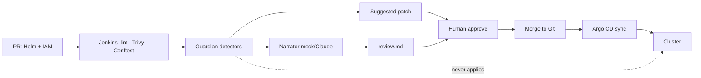

# AI GitOps Release Guardian: evidence-based risk reviews for Terraform and Kubernetes changes

> **The problem:** a pull request that cuts a memory limit, opens a public load balancer, and widens an IAM policy can still look like “just values.” CI scanners fire, but a reviewer has to stitch the diff and the checks into a story before merge. **The fix:** a **read-only** guardian that reviews the GitOps change, **cites the files and CI checks**, and **suggests a safer patch**. Argo CD remains the deployer. The model never applies.

A Jenkins (or local) pipeline runs fmt/validate, Trivy, and policy tests. The guardian reads the **diff + those artifacts**, produces a short report, and writes a patch for a human. Swap the mock narrator for **Claude** when `ANTHROPIC_API_KEY` is set — findings stay detector-owned either way.

Runs on a laptop. No cluster, no cloud account, no bill.

**Architecture:** [docs/architecture.md](docs/architecture.md) · motion diagram [`linkedin/architecture.html`](linkedin/architecture.html)



---

## What it does

```
PR (Helm values + Terraform IAM)
        │
        ▼
 CI: helm lint · terraform fmt · Trivy config · Conftest/Rego
        │  artifacts
        ▼
 Guardian detectors (deterministic) ──► findings + evidence locators
        │
        ├── LLM narrator (mock | Claude) — explains, does not invent
        └── suggested unified diff — human review only
        │
        ▼
 Human approves the PR
        │
        ▼
 Argo CD syncs Git  (guardian has no apply / no app sync)
```

| Piece | Why it matters | How it works here |
|---|---|---|
| **Detectors, not vibes** | Recruiters can see *why* a finding exists | Memory floor, public LB, IAM wildcards — unit-tested |
| **Evidence** | A reviewer can verify before merge | Each finding cites file:line, the unified diff, Trivy IDs, Conftest policy IDs |
| **Suggested patch** | Faster than “please fix” comments | Chained edits restore ClusterIP, memory floors, scoped IAM |
| **Read-only** | Safer demo than an agent that can `kubectl apply` | No apply in `guardian/`; Argo Application has `automated: null` |
| **Pluggable LLM** | Free in CI, real when you want | Mock narrator by default; Claude only writes prose |

---

## Run it

```bash
make test            # detectors + patch + read-only contract
make demo            # review the risky checkout PR (no API key)
make safer           # write the patch to out/safer and re-review (should go green)
make mcp             # read-only MCP tools: findings + Argo status fixture
```

Optional narration:

```bash
export ANTHROPIC_API_KEY=sk-...
make demo            # same findings, Claude writes the narrative
```

### What `make demo` proves

The proposed PR (vs `demo/baseline`) does three things at once:

1. **Cuts checkout memory** `512Mi/1Gi` → `64Mi/128Mi` in `charts/checkout/values.yaml`
2. **Publishes a public load balancer** (`service.type: LoadBalancer`, `internet-facing`)
3. **Widens IAM** to `s3:*` + `iam:*` on `Resource = "*"` in `terraform/iam.tf`

The guardian **blocks** the change, attaches **Trivy + Conftest** evidence, and proposes a patch. Re-reviewing the patched tree clears those findings. Argo CD is documented as the only sync path (`gitops/application.yaml`).

---

## Layout

```
demo/baseline/          # currently deployed Git (Helm + IAM)
demo/proposed/          # the risky PR
demo/ci-results/        # Trivy + Conftest fixtures (laptop, no scanners required)
policies/*.rego         # same floors the detectors enforce
ci/Jenkinsfile          # fmt → scan → policy → guardian → human gate
gitops/application.yaml # Argo CD; automated sync off
guardian/               # review engine (never applies)
tests/                  # the proofs above
```

Jenkins is the CI shape you would run in a real platform team; this repo ships the Jenkinsfile and fixtures so the demo does not need a Jenkins controller. Point an existing Jenkins at `ci/Jenkinsfile` when you want the live pipeline.

---

## MCP (read-only, later-stage)

`python -m guardian.mcp_server` speaks JSON-RPC over stdio:

| Tool | Mutates? |
|---|---|
| `get_last_review` | no |
| `list_findings` | no |
| `get_suggested_patch` | no (returns diff, `applied: false`) |
| `get_gitops_context` | no (reads `gitops/status.json`) |

There is no `sync` tool. Pair this later with [Argo CD MCP](https://github.com/argoproj-labs/mcp-for-argocd) for live application status — keep mutations in Argo, keep analysis here.

---

## Portfolio title

**AI GitOps Release Guardian: Evidence-Based Risk Reviews for Terraform and Kubernetes Changes**
