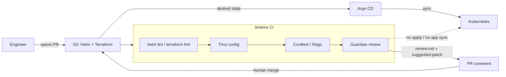
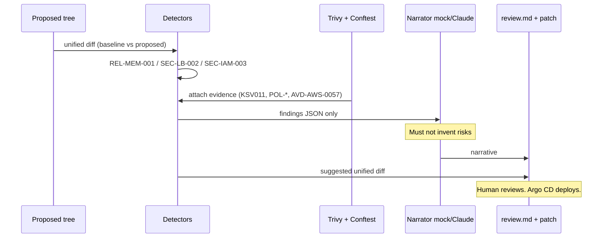

# Architecture — AI GitOps Release Guardian

The guardian is a **read-only review stage** in an existing GitOps path. Jenkins still lint-scans-policy. Argo CD still deploys. The model never applies Terraform and never syncs an Application.

Motion diagram (open in a browser): https://hanumanthvendra.github.io/gitops-release-guardian/

## System context

## Review pipeline (inside the guardian)

## Control plane vs data plane

| Layer | Owns | Must not |
|---|---|---|
| Detectors + Rego + Trivy | Whether a finding exists | Talk to the cluster |
| LLM narrator | Wording of the report | Add findings, apply patches |
| Human + Jenkins `input` | Merge decision | Skip evidence |
| Argo CD | Reconcile Git → cluster | Be driven by the model |

Read-only MCP tools (`get_last_review`, `list_findings`, `get_suggested_patch`, `get_gitops_context`) expose the last report and a status fixture. There is no `sync` tool. Pair later with Argo CD MCP for live application status — keep mutations in Argo.
